# PromptCraft AI — 120-Minute Workshop Plan

**Target Audience:** 1st and 2nd Year Computer Science Engineering Undergraduates  
**Total Workshop Duration:** Exactly 120 Minutes (2.0 Hours)  
**Format:** Interactive Lecture, Live Coding Diagnostics, Pair Hands-On Lab, and Assessment

---

## Workshop Schedule Breakdown

```mermaid
gantt
    title PromptCraft AI — 120-Minute Workshop Timeline
    dateFormat  mm
    axisFormat  %M m
    section Theory & Foundations
    1. Intro to AI & Prompting (10m)    :active, 00, 10m
    2. Prompt Basics & Mistakes (15m)   :00, 15m
    3. Core Pillars (Role, Task, Context, Format) (20m) :00, 20m
    4. Few-Shot & Advanced Techniques (15m) :00, 15m
    section Rest & Synthesis
    5. Break & Open Q&A (10m)           :00, 10m
    section Hands-On Lab
    6. Hands-On Coding & Study Exercises (20m) :00, 20m
    7. Before-and-After Refactoring Activity (15m) :00, 15m
    section Ethics & Assessment
    8. AI Verification & Security Ethics (10m) :00, 10m
    9. Interactive Quiz & Wrap-Up (5m)  :00, 5m
```

---

## Detailed Session Roadmap

### Session 1: Introduction to AI and Prompt Engineering (10 Minutes)
- **Time:** Minute 00 - 10
- **Objective:** Demystify how autoregressive LLMs predict tokens without consciousness; establish prompt engineering as an essential developer interface.
- **Activity:** Live demo comparing a raw one-liner request vs. a structured prompt.
- **Outcome:** Students understand the GIGO (Garbage In, Garbage Out) principle in generative AI.

### Session 2: Prompt Basics and Common Student Mistakes (15 Minutes)
- **Time:** Minute 10 - 25
- **Objective:** Analyze top 5 pitfalls (vague tasks, unstated assumptions, missing language versions, lack of edge cases).
- **Activity:** Rapid interactive spot-the-flaw challenge using sample prompt failures.
- **Outcome:** Students learn to diagnose unstated assumptions before running code.

### Session 3: Role, Task, Context, and Format Prompting (20 Minutes)
- **Time:** Minute 25 - 45
- **Objective:** Master the 4 core pillars: Role priming for vocabulary, imperative action verbs for tasks, environment context, and strict schema output.
- **Activity:** Students take a weak question and iteratively layer on each of the 4 pillars.
- **Outcome:** Ability to command structured outputs (JSON schemas, Markdown comparison tables).

### Session 4: Few-Shot and Advanced Prompting Approaches (15 Minutes)
- **Time:** Minute 45 - 60
- **Objective:** Explore in-context learning with 1-shot and 2-shot demonstrations; introduce Step-by-Step reasoning for complex logic.
- **Activity:** Convert unstructured log text into JSON tickets using a 2-shot template.
- **Outcome:** Predictable output formatting and reduced reasoning leaps.

### Session 5: Break and Open Questions (10 Minutes)
- **Time:** Minute 60 - 70
- **Objective:** Mental consolidation and informal peer questions.
- **Activity:** 10-minute timer displayed with background lo-fi music; instructor circulates room.
- **Outcome:** Refreshed attention span ahead of the hands-on lab.

### Session 6: Hands-On Coding and Study Exercises (20 Minutes)
- **Time:** Minute 70 - 90
- **Objective:** Put theory into practice with real engineering challenges:
  1. *Challenge A:* Debug a segmentation fault in a C++ Binary Search Tree.
  2. *Challenge B:* Generate boundary JUnit test cases for an e-commerce coupon engine.
  3. *Challenge C:* Build a comparative database schema matrix.
- **Activity:** Pair programming using the PromptCraft AI web application.
- **Outcome:** Muscle memory in constructing multi-part engineered prompts.

### Session 7: Before-and-After Prompt Improvement Activity (15 Minutes)
- **Time:** Minute 90 - 105
- **Objective:** Use the Prompt Playground to optimize real prompts from students' past week of college coursework.
- **Activity:** Paste a raw query, inspect diagnostic score, review suggested additions, and save to personal Prompt Library.
- **Outcome:** Practical, tangible artifacts saved to students' local browser libraries.

### Session 8: AI Verification and Ethics (10 Minutes)
- **Time:** Minute 105 - 115
- **Objective:** Recognize hallucinations (phantom libraries, fabricated citations), security vulnerabilities (SQL injection, plaintext credentials), and academic honesty guardrails.
- **Activity:** Walk through the 8-point Verification Checklist on a defective AI code snippet.
- **Outcome:** Healthy skepticism; treating every AI response as an unverified draft.

### Session 9: Quiz and Feedback (5 Minutes)
- **Time:** Minute 115 - 120
- **Objective:** Measure retention across the 12 core workshop concepts and celebrate high scorers.
- **Activity:** Cohort completes the 12-question quiz; instructor reviews top missed concept.
- **Outcome:** Quantified mastery certificates and JSON data backup export.

---

## Total Workshop Duration Verification
10 + 15 + 20 + 15 + 10 + 20 + 15 + 10 + 5 = **120 Minutes (Exactly 2 Hours)**.
